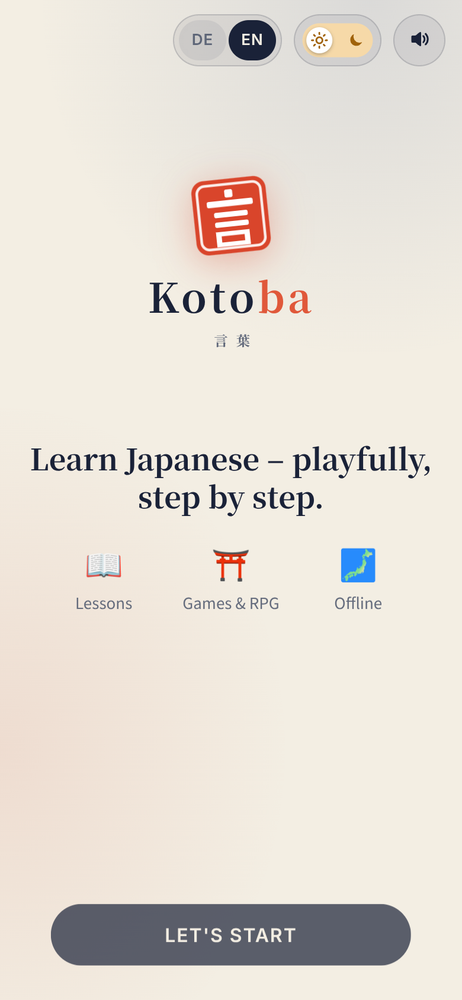
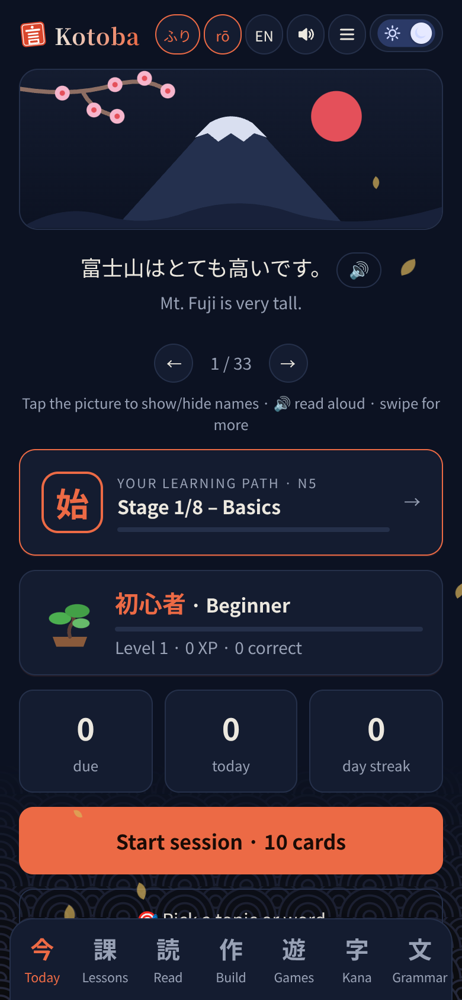
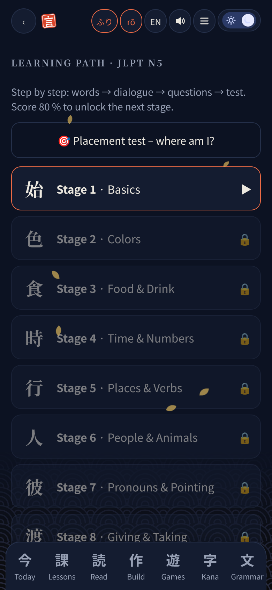
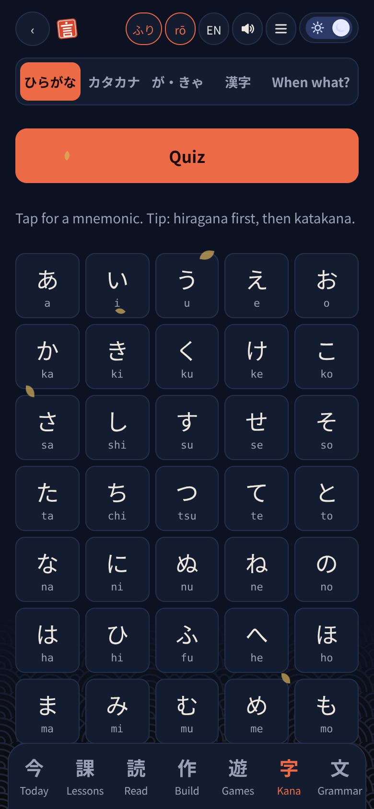
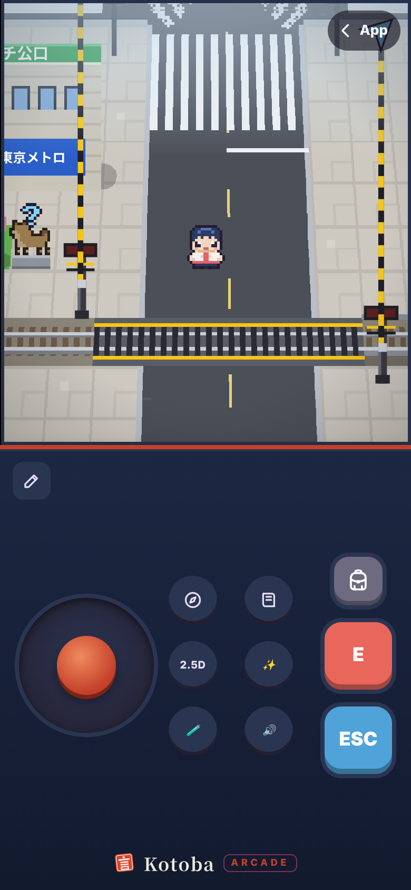
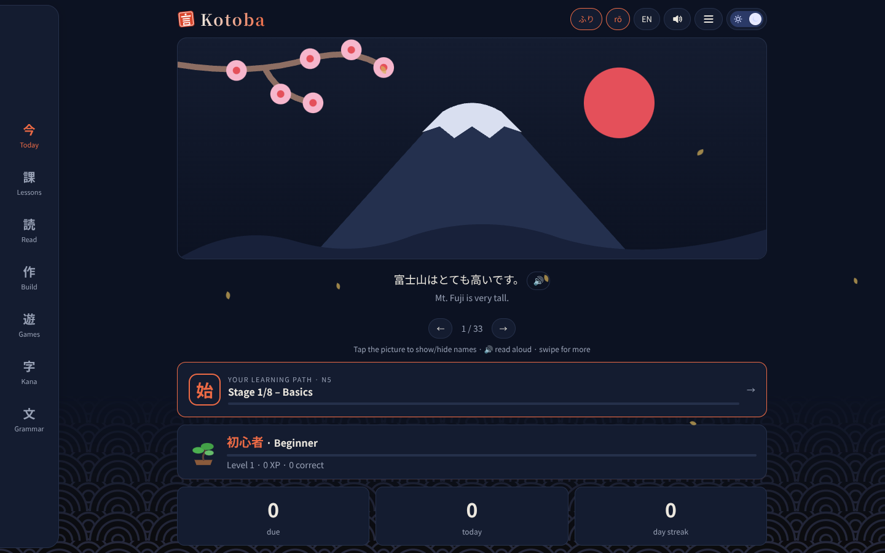
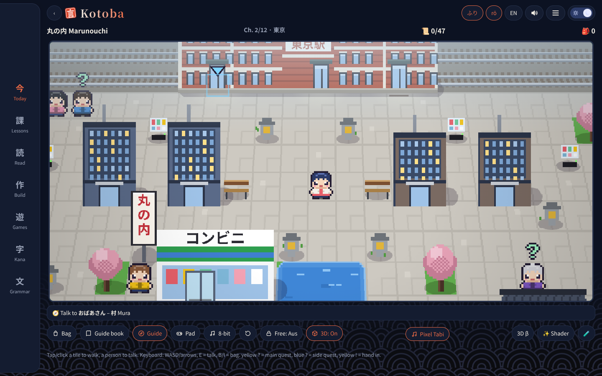
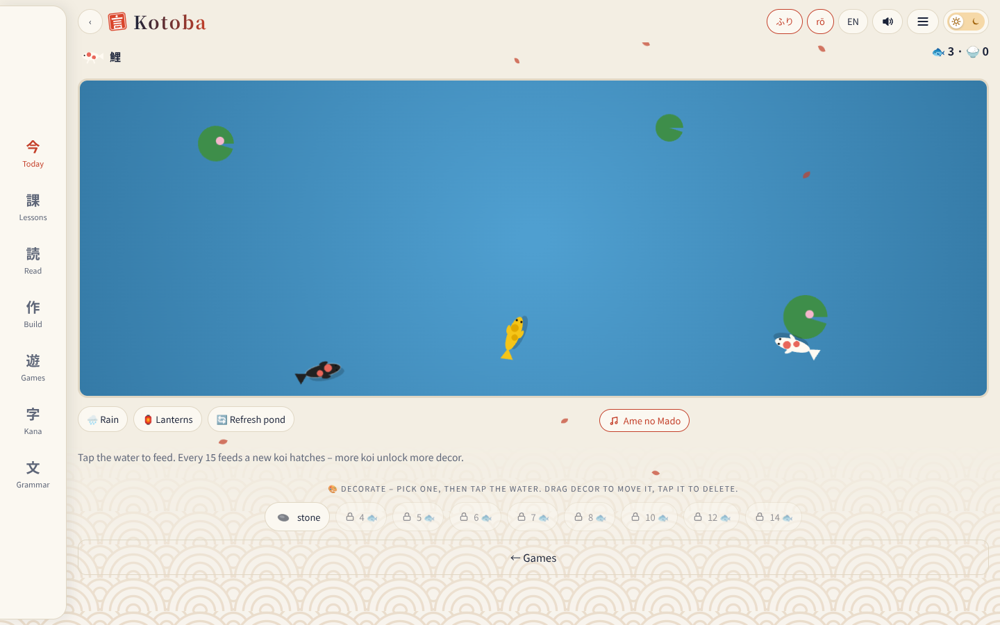
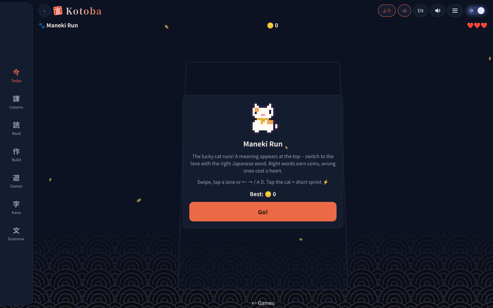

<p align="center">
  
</p>

<h1 align="center">Kotoba 言葉</h1>

<p align="center">
  <b>Learn Japanese – playfully, step by step.</b><br>
  Lessons · learning path to JLPT N5 · reading · games · an RPG across Japan · calm chill modes<br>
  Offline · no ads · no tracking · free and open source
</p>

<p align="center">
  <a href="https://cyberpanda.github.io/kotoba.html"><b>▶ Try the live demo</b></a> ·
  <a href="../../releases">Download the apps</a> ·
  <a href="docs/DEPLOY-WEB.md">Host it yourself</a> ·
  <a href="docs/BUILD.md">Build from source</a>
</p>

<p align="center">
  <a href="LICENSE"></a>
  
  
</p>

<p align="center">
  
  
  
  
  
</p>

---

## ようこそ – Welcome!

*Kotoba* (言葉) means **“words / language”**. It is a friendly little app that helps you grow your
Japanese one word at a time: short sessions that never dead-end, real sentences with furigana and
read-aloud, mnemonics and pictures, a clear path to JLPT N5 – and when you need a break, a pixel-art
adventure through Japan or a koi pond to feed.

It runs everywhere: in the browser, installed on your phone’s home screen, or as a native app on
iPhone, iPad, Android, Mac, Windows and Linux. Your progress stays on your device.

**Interface language:** English or German – pick it on the welcome screen or with **EN / DE** at the top.

## ✨ Highlights

| | |
|---|---|
| 🧭 **Learning path** | 8 stages to JLPT N5: words → dialogue → questions → test, plus a placement test |
| 📖 **Today & lessons** | spaced repetition, swipeable word cards, example sentences, mnemonics, ★ favourites |
| 字 **Kana & kanji** | hiragana, katakana, dakuten, 45 kanji with readings and memory hooks, quizzes |
| 読 **Read & build** | sentences with toggleable furigana / rōmaji, haiku, sentence tiles, typing in kana |
| ⛩️ **Bōken RPG** | 12 chapters across Japan – Tokyo Station, Shibuya, Kyoto, Osaka, Hokkaido, Mt. Fuji … in 2D, 2.5D or 3D |
| 🎮 **Games** | Maneki Run, 60-second challenge, picture path, giving & taking, こそあど, songs |
| 🌿 **Chill 癒し** | bonsai, zen garden, koi pond, guided breathing counted in Japanese |
| 🔊 **Voice & music** | read-aloud (system voices, optional neural HQ voices), calm generative music |
| 🌗 **Comfort** | dark & light mode, works offline, installable, no account, no tracking |

<p align="center">
  
  
</p>
<p align="center">
  
  
</p>

## 📲 Get Kotoba

| Platform | How |
|---|---|
| **Browser** (any device) | open the [live demo](https://cyberpanda.github.io/kotoba.html) |
| **iPhone · iPad** | Safari → Share → **Add to Home Screen** – or the native app (`.ipa`, TestFlight / App Store) |
| **Android** | `Kotoba_x.y.z_android.apk` from [Releases](../../releases) – or Chrome → ⋮ → **Install app** |
| **macOS** | `Kotoba_x.y.z_universal.dmg` from [Releases](../../releases) (Apple Silicon + Intel) |
| **Windows 10/11** | `Kotoba_x.y.z_x64-setup.exe` (or `_arm64-setup.exe`) from [Releases](../../releases) |
| **Linux** | `Kotoba_x.y.z_amd64.AppImage` / `_aarch64.AppImage` (or `.deb` / `.rpm`) from [Releases](../../releases) |
| **Your own server** | `kotoba-web-x.y.z.zip` from [Releases](../../releases) → [hosting guide](docs/DEPLOY-WEB.md) |

All versions are the same app and work fully offline after the first start.

## 🚀 Quick start for developers

```bash
git clone https://github.com/cyberpanda/kotoba && cd kotoba
python3 tools/build.py        # → dist/web (split site), dist/standalone/kotoba.html (one file)
make serve                    # http://localhost:8080
```

| Goal | Command | Guide |
|---|---|---|
| Host on nginx / Apache / Caddy / Docker / Pages | `make build` · `docker compose up` | [DEPLOY-WEB.md](docs/DEPLOY-WEB.md) |
| macOS app | `make mac` | [BUILD.md](docs/BUILD.md#2-macos-app) |
| iPhone & iPad (.ipa) | `make ios-init` · `make ipa` | [BUILD.md](docs/BUILD.md#3-iphone--ipad-ipa) |
| Android (.apk / .aab) | `make android-init` · `make apk` | [BUILD.md](docs/BUILD.md#5-android-apk--aab) |
| Windows, Linux, Android (+ live demo update) | push a tag – GitHub Actions builds everything | [RELEASING.md](docs/RELEASING.md) |
| Browser tests | `make qa` | [QA.md](docs/QA.md) |

The native apps are built with [Tauri 2](https://v2.tauri.app) and use the system web view – small
downloads, no bundled browser.

<details>
<summary><b>Repository layout</b></summary>

```
src/            the app – index.html, fonts/, icons/
src-tauri/      native shell for iOS/iPadOS, Android, macOS, Windows, Linux (Tauri 2)
tools/          build.py · qa.py · icons.py · build_fonts.py · ios_setup.py · android_setup.py · world/
deploy/         nginx.conf · apache.htaccess · Caddyfile
linux/          install.sh – lightweight launcher without AppImage
docs/           BUILD · DEPLOY-WEB · RELEASING · QA · screenshots
.github/        CI (build + browser QA) · Release (all platforms) · Pages (live demo)
dist/           build output (git-ignored)
```
</details>

<details>
<summary><b>All features in detail</b></summary>


- **Learning path 🧭 (JLPT N5)** – 8 stages in order: learn the words → read & listen to a dialogue → comprehension questions → 10-question test (pass with 8 to unlock the next stage); placement test to find your level
- **Today** – daily sessions with spaced repetition and swipeable word cards; sessions never dead-end: keep going mixed, pick a topic or a single word, or switch on endless mode
- **Lessons** – each lesson has its own page; every word has its own page with example sentences where the word is highlighted, plus gap-sentence games; vocabulary with kana, romaji and mnemonics; save words ★ or mark them as hard ⚑
- **Read** – sentences with vocabulary above them, toggleable furigana and romaji, simple texts and public-domain haiku (Bashō, Issa, Shiki)
- **Build** – arrange sentences from tiles, type freely (romaji or kana), notebook for your own sentences
- **Chill 癒し** – endless relaxing modes that save their state: a bonsai you prune by swiping (it grows back over time, even while closed; water, pot colors, day/night), a zen rock garden to rake and place stones, a koi pond to feed (new koi hatch, rain and lanterns), and guided breathing counted in Japanese
- **Game music** – every game has its own soundtrack with a per-game on/off toggle; music crossfades smoothly and returns to your app music (or silence) when you leave
- **Maneki Run 招き猫** – 2D endless runner (speeds up as you improve; tap the cat for a short sprint ⚡): the lucky cat switches lanes to the right Japanese word for the shown meaning, collects coins, combo multiplier, 3 hearts, record
- **Bōken RPG 冒険** – an 8-bit journey across Japan in 12 chapters, each a themed world of several maps that ends at a train station leading to the next: home village & town (spring) → Tokyo (Marunouchi plaza with the enterable red-brick Central Station building and tracks leading out of it, station hall with ticket gates, ekiben stands and platforms where the Shinkansen arrives and departs, Shibuya Crossing, Shinjuku, Asakusa, Akihabara, Ueno, Tokyo Tower) → summer coast with night festival and Miyajima’s floating torii → Kyoto & Nara (golden pavilion, Fushimi Inari, Great Buddha hall, hot-spring inn) → Osaka (Dōtonbori at night, Osaka Castle) → Hokkaido (Sapporo clock tower, snow village, snowy peak) → Mt. Fuji (5th station and summit at sunrise) → Kanazawa → Hiroshima → Fukuoka → Nagasaki → Okinawa, plus the Odaiba harbour, Tokyo Skytree, the Metropolitan Government Building and Akihabara anime billboards. 34 maps plus 19 enterable buildings (school, shrines, temples, museum, castle keep, houses and shops) whose interiors have objects to examine (shelves, menus, offering boxes, exhibits), hidden finds for XP and people to chat with with a scrolling camera, landmark buildings drawn as detailed pixel art, seasonal weather and lighting, 47 quests that send you back and forth between maps and chapters, a 🧭 guide that shows the next goal with an on-screen arrow (switchable, the world stays open), trains that arrive at and depart from every platform with station announcements, occasional passing trains with flashing level crossings and lowering barriers, cars, traffic lights and pedestrians (some with a ? ask you quick vocabulary questions for XP), clearly signposted exits with destination names, a subway between the Tokyo districts, a station menu at every platform with an animated train ride through Japanese landscapes, a yellow ? for main and a blue ? for side quests, a yellow ! when you can hand something in, a bag (B or I), a travel guide book per chapter (places, things to do, useful phrases), hints that link to the matching lesson, click/tap-to-walk, WASD/arrows + E and an on-screen joystick on touch devices; the view adapts to the screen (tall on phones in portrait, wide in landscape and on desktop); words from the adventure are part of the lessons too; the Japanese builds up gradually: chapter 1 leads with the translation, from chapter 3 translations appear on tap, from chapter 5 romaji too; an optional 2.5D view (🎥) with a tilted ground and upright sprites; own chiptune music and sound effects with a soundscape per region (see Sound below)
- **Experimental graphics 🧪** – optional toggle (🧪 chip in the RPG bar, 🧪 button in arcade mode); the classic look stays as the default/backup. 3D: filmic ACES tone mapping, HDR bloom, image-based lighting, soft 2K shadows, distance haze, color grading and vignette, plus new procedural models (curved kawara tile roofs with bump-mapped tiles, ridge tiles and rafters, gable ends, timber posts, glowing chōchin lanterns, Itsukushima-style torii with curved kasagi, plaque and support legs, layered pines and clustered foliage). 2D/2.5D: light grading, soft glow, vignette and a detailed torii sprite. All models are generated in code – no third-party 3D assets, so no extra attribution is required
- **Shader mods ✨** – separate toggle (✨ Shader chip, ✨ arcade button) for 3D: realistic animated water (procedural normal map, reflections of the sky light, fresnel-like sheen), screen-space ambient occlusion (SSAO), relief normal maps for the ground, plus the filmic pipeline. With 🧪 on, players, NPCs and pedestrians are real anime-style 3D characters (large eyes with highlights, bangs, hairstyles, ponytails, buns, kimono with obi, aprons, glasses, caps, straw hats, headbands, bronze statues) and Nara deer (stags with antlers), Shiba dogs and pandas are 3D animals, all with walk animation, and props (vending machines, ticket machines, benches, fences, shelves, food stalls, parasols, snowmen) are real 3D models – all generated in code in one consistent style, no third-party assets
- **Welcome & offline** – responsive welcome dialog (fits every screen size, scrollable sections) that asks for consent before preloading all resources (3D engine, graphics effects, building blocks for future games, optional HQ voice) so the app works offline; resources are reloaded automatically after each update, progress and saves are never touched. Includes step-by-step guides for installing the app on the home screen (iOS 26 Safari “Open as Web App”, Android Chrome/Samsung/Firefox, desktop) with one-tap install where the browser supports it, plus a hint that the iPhone Duo/foldables lose the browser bars as an installed app; reachable later via ⚙️ → “Install app & offline”
- **HQ voices** – voice list in ⚙️ sorted best first: Piper neural voices (Tsukuyomi-chan, CSS10 Japanese; downloaded once, then offline), system voices, Kotoba Voice; automatic fallback if a voice can’t load
- **Read-aloud 🔊** – Japanese text-to-speech via the browser’s built-in Web Speech API (no external service); adjustable speed. Uses the Japanese voice installed on your device – or the built-in **Kotoba Voice**, a small self-made formant speech synthesizer (Web Audio, fully offline, MIT) selectable in ⚙️ settings and used automatically when no Japanese system voice exists
- **Picture path** – learn like a child, adapted for adults: picture → word, word → picture, scenes → sentence, with optional 💡 hints (pronunciation + meaning)
- **Games** – 60-second challenge, giving & taking (あげる/くれる/もらう) with SVG pictures, drag and drop or tap-to-move, こ・そ・あ・ど, pronouns
- **Kana & Kanji** – “When what?” guide (kanji vs hiragana vs katakana, dakuten ゛, handakuten ゜, small っ/ゃ, long vowels, pitch accent) with color-coded scripts; dakuten and combo kana (が, きゃ); hiragana and katakana charts with mnemonics, 45 kanji with on/kun readings and mnemonics, quizzes, kanji-in-sentences game
- **Anime phrases** – 22 typical anime expressions explained (nuance, politeness, who says them), with quiz
- **Songs** – original anime-opening-style lyrics (JP/EN/DE) with fill-the-gap game
- **Romaji on/off** – when off, romaji is hidden and typed answers must be kana
- **Grammar** – compact explanations with examples
- Japanese look: romaji wordmark “Kotoba”, endless swipeable home banner with 33 Japan scenes (Mt. Fuji, torii, tea, bonsai, festival, sushi, ramen, castle, pagoda, shinkansen, onsen, kotatsu, origami, Nara deer, kimono, Tanabata, sumo and more), each with a caption sentence and 🔊 read-aloud – tap to show/hide the Japanese names of every object; falling leaves, seigaiha wave pattern, mincho headings – all drawn in code, no third-party artwork
- **Levels & XP** – ranks from 初心者 to 名人, sakura bursts on correct answers, streak and milestone toasts
- **Translations in games** – optional translated subtitles under Japanese questions
- **Background music** (⚙️ settings): 11 tracks; the calm ambient track *Kumo* plays by default (starts on your first tap, browsers block autoplay) – Kumo, Sakura Piano, Lofi Yoru, Koto Ame, Ame no Mado, Shakuhachi Kaze, Zen Niwa, Matsuri, City Pop Yoru with volume control – generated live with the Web Audio API from Japanese in/yo scales, so there are no audio files and no third-party licenses or attribution needed
- Dark mode by default, light mode toggle
- Responsive for phone, tablet and desktop, portrait and landscape
- Progress stays in your browser: no account, no tracking

</details>

## The name · 言葉

**Kotoba (言葉)** is Japanese for *word*, *language* or *expression*.
It is written with two kanji: **言** (*koto* – to say, to speak) and **葉** (*ba* – leaf).
Literally: *“the leaves of speech”* – words growing like leaves on a tree. The image goes back to the
preface of the Kokin Wakashū poetry anthology (around 905). A fitting name for an app that helps you
grow your own Japanese, one word at a time.

## Why Kotoba exists

I’ve known a little Japanese for most of my life – mostly from anime and later Duolingo. But I never
really stuck with any learning app, because something was always missing for me: keeping vocabulary,
reading whole sentences, understanding grammar and actually starting to speak – German ↔ Japanese,
with English as my bridge language.

So I wanted **one app that works the way I learn**:

- short sessions several times a day that never dead-end
- real sentences with the important words and their pronunciation right above them
- mnemonics, colors and pictures so words actually stick
- a clear path to improve level by level – with dialogues and tests
- playful practice (games, an RPG, a lucky-cat runner) and calm modes to relax
- dark mode, Japanese aesthetics, read-aloud, offline, no ads, no tracking
- usable by anyone, on iPhone, Android, tablet and desktop

**Kotoba is exactly that – finally an app the way I imagined it.**

## How it was made

Made overnight in one session of about 4 hours – building and testing together with AI (Claude),
based on my ideas and feedback. Everything external was restricted to open-source or public-domain
material, documented in [CREDITS.md](CREDITS.md).

<details><summary>🇩🇪 Kurz auf Deutsch</summary>

**Kotoba (言葉)** heißt „Wort / Sprache“ – wörtlich „Blätter des Sprechens“ (言 sprechen + 葉 Blatt).

Ich kann mein Leben lang schon etwas Japanisch – überwiegend durch Anime und Duolingo. Lern-Apps habe ich
aber nie lange genutzt, weil mir immer irgendetwas gefehlt hat: Vokabeln behalten, Sätze lesen, Grammatik
verstehen und selbst sprechen. Kotoba ist so gebaut, wie ich lerne: kurze Sessions, echte Sätze mit
Aussprache, Eselsbrücken, Bilder und Farben, ein klarer Lernpfad mit Dialogen und Prüfungen, Spiele, RPG
und Chill-Modi – dark, japanisch, offline, ohne Werbung und Tracking.

Über Nacht in einer Session von rund 4 Stunden entstanden. **Endlich eine App nach meinen Vorstellungen.**
</details>

## 🔒 Privacy

Kotoba does **not** collect or transmit personal data – no account, no cookies, no tracking, no
analytics. Progress and settings live only in your browser’s storage (or the app’s on-device storage)
and can be wiped any time with ⚙️ → **Delete data**. Fonts, images and music are bundled or generated
in code. Optional downloads (3D engine, neural voices) are fetched only after you agree on the
welcome screen. Details: [PRIVACY.md](PRIVACY.md).

### Sound

All music and sound effects are synthesized live with the Web Audio API – there are no audio files and no third-party samples, so no attribution is required. In the adventure every region has its own theme and ambience:

| Region | Music | Ambience |
|---|---|---|
| Home village & town | yo scale, triangle melody | birdsong |
| Stations | ryūkyū-style major pentatonic | station platform chime, low hall noise |
| Railway lines | – | synthesized pass-by rumble with wheel clatter, crossing bells near level crossings |
| Tokyo | upbeat chiptune with beat | city hum, crossing signal at Shibuya |
| Summer coast & festival | fue flute (vibrato) over taiko | waves, cicadas |
| Kyoto & Nara | koto plucks in the in scale | temple bell |
| Osaka | fast shamisen-style plucks | crowd murmur |
| Hokkaido | slow bell tones | wind |
| Mt. Fuji | shakuhachi breath and pads | mountain wind |
| Indoors | quiet koto | – |

Everything follows the music volume and switches off with the music toggle.

### Read-aloud voices

Kotoba speaks the **kana reading** of every word and sentence, so it sounds right even on engines that
can’t read kanji (e.g. eSpeak NG on Linux, which otherwise says “Chinese letter”). For good results install
a Japanese voice (otherwise the built-in, robot-like Kotoba Voice is used):

- **iPhone/iPad:** Settings → Accessibility → Spoken Content → Voices → Japanese (e.g. Kyoko)
- **Android:** Settings → Text-to-speech → install Japanese voice data
- **Windows:** Settings → Time & language → Language → add Japanese (with speech)
- **Linux (Mint, Ubuntu, Debian):** `sudo apt install speech-dispatcher espeak-ng` – Chrome/Chromium then offers a Japanese eSpeak voice; for a more natural voice use Chrome’s online Google voices or Open JTalk

## 🙏 Credits & sources

Everything – code, illustrations, pixel art, music, lyrics, lessons – was created for this project
under the [MIT License](LICENSE). Third-party material, all open source or public domain:

- Fonts: [Noto Sans / Serif CJK JP](https://github.com/notofonts/noto-cjk) (SIL OFL 1.1) and
  [DejaVu Sans Mono](https://dejavu-fonts.github.io/) – bundled as subsets in `src/fonts/`
- 3D (optional): [three.js](https://github.com/mrdoob/three.js) (MIT)
- HQ voices (optional): [piper-plus](https://github.com/ayutaz/piper-plus) (MIT),
  [ONNX Runtime Web](https://github.com/microsoft/onnxruntime) (MIT),
  voice *Tsukuyomi-chan* – つくよみちゃんコーパス (CV.夢前黎)
- Native apps: [Tauri](https://github.com/tauri-apps/tauri) (MIT / Apache-2.0)
- Haiku by Matsuo Bashō, Kobayashi Issa and Masaoka Shiki – public domain

Full list with licenses: **[CREDITS.md](CREDITS.md)** · Changes: **[CHANGELOG.md](CHANGELOG.md)**

The project was built together with AI (Claude), using only open-source, public-domain or
self-created material. If you believe something infringes your rights, please
[open an issue](../../issues) – it will be fixed or removed promptly.

---

<p align="center">
  Made with 🍵 by <b>CyberPanda</b> ·
  <a href="https://github.com/CyberPanda">GitHub</a> ·
  <a href="https://x.com/realcyberpanda">X @realcyberpanda</a><br>
  がんばって！ – good luck with your Japanese!
</p>
