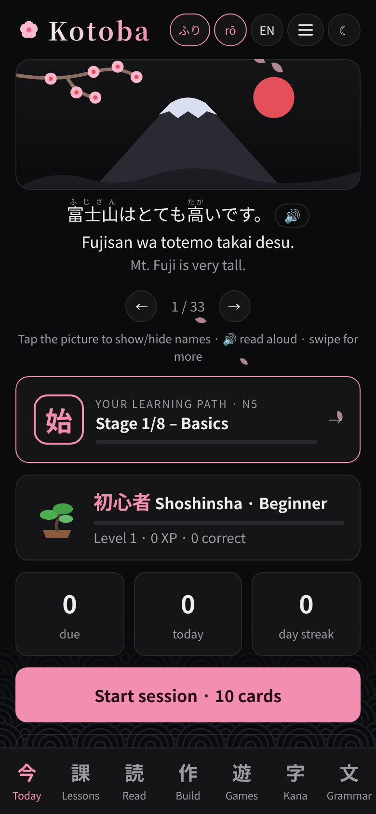
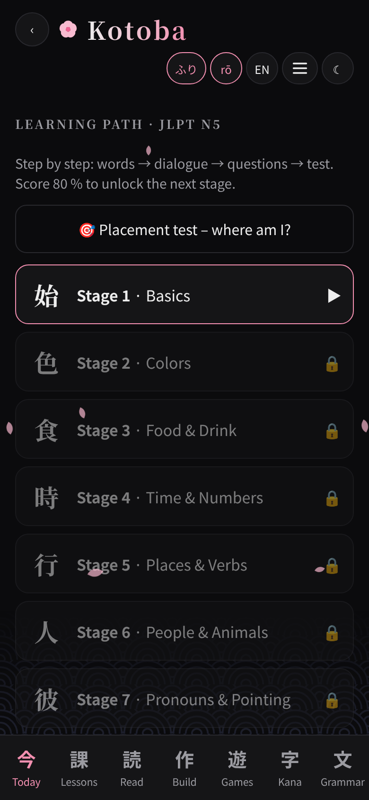
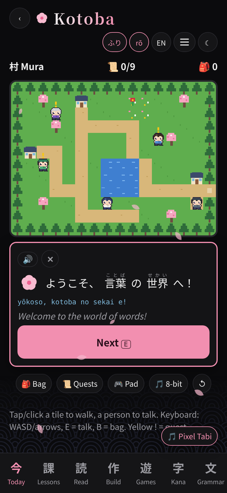
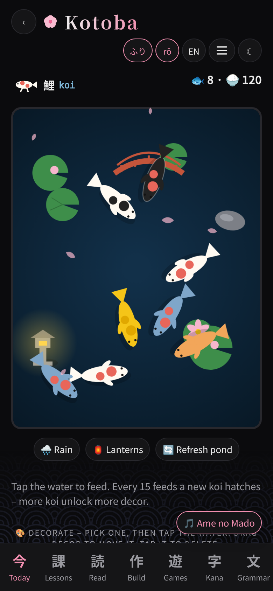
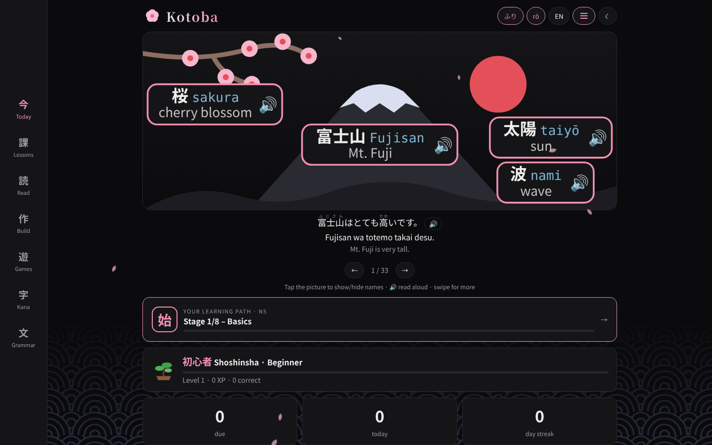
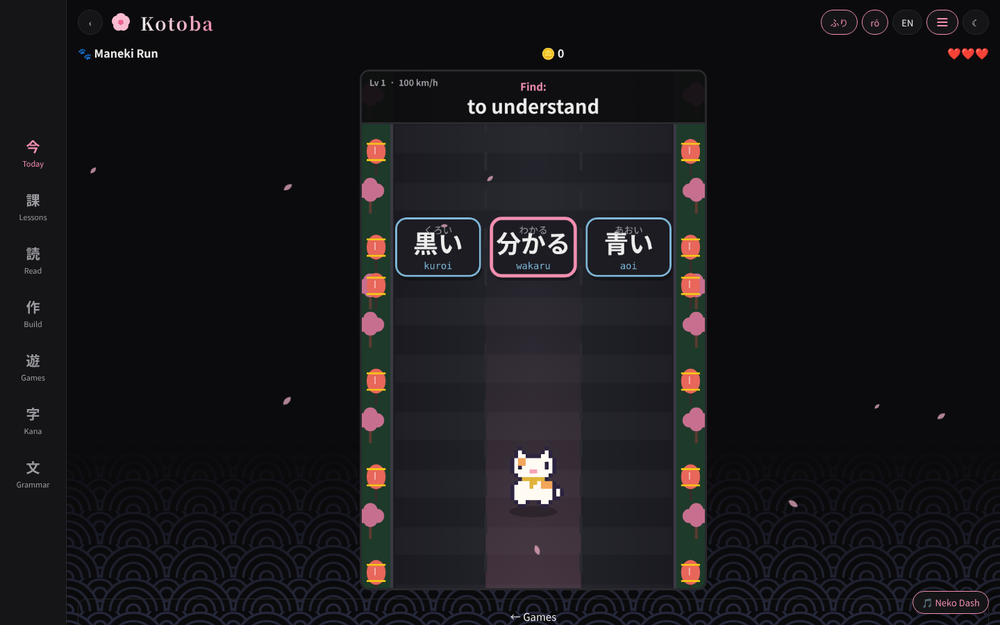
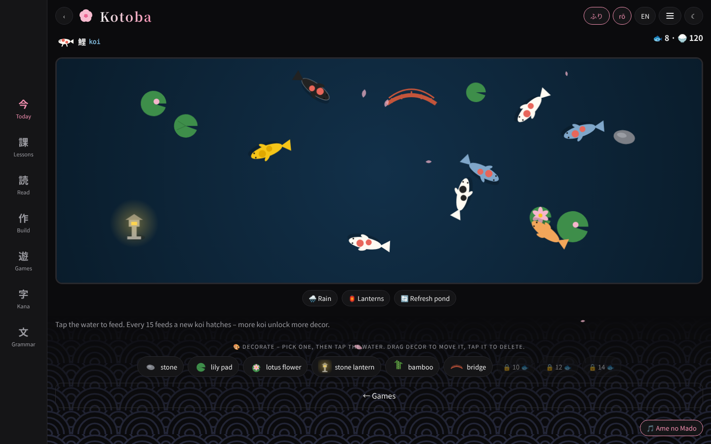

# Kotoba 言葉

*Kotoba* (言葉) means “words / language”.

Learn Japanese interactively – a single HTML page that runs in any modern browser on iOS, Android, macOS, Windows and Linux. Installable as a web app (PWA) and works offline. Works on phones, tablets and desktops in portrait and landscape.

**Interface language:** English by default. Switch to German with the **EN / DE** toggle at the top.

<p align="center">
  
  
  
  
</p>
<p align="center">
  
</p>
<p align="center">
  
  
</p>

## The name · 言葉

**Kotoba (言葉)** is Japanese for *word*, *language* or *expression*.
It is written with two kanji: **言** (*koto* – to say, to speak) and **葉** (*ba* – leaf).
Literally: *“the leaves of speech”* – words growing like leaves on a tree. The image goes back to the
preface of the Kokin Wakashū poetry anthology (around 905). A fitting name for an app that helps you
grow your own Japanese, one word at a time.

## Why Kotoba exists

I’ve known a little Japanese for most of my life – mostly from anime and later Duolingo. But I never
really stuck with any learning app, because something was always missing for me: keeping vocabulary,
reading whole sentences, understanding grammar and actually starting to speak – German ↔ Japanese,
with English as my bridge language.

So I wanted **one app that works the way I learn**:

- short sessions several times a day that never dead-end
- real sentences with the important words and their pronunciation right above them
- mnemonics, colors and pictures so words actually stick
- a clear path to improve level by level – with dialogues and tests
- playful practice (games, an RPG, a lucky-cat runner) and calm modes to relax
- dark mode, Japanese aesthetics, read-aloud, offline, no ads, no tracking
- usable by anyone, on iPhone, Android, tablet and desktop

**Kotoba is exactly that – finally an app the way I imagined it.**

## How it was made

Made overnight in one session of about 4 hours – building and testing together with AI (Claude),
based on my ideas and feedback. Everything external was restricted to open-source or public-domain
material, documented in [CREDITS.md](CREDITS.md).

<details><summary>🇩🇪 Kurz auf Deutsch</summary>

**Kotoba (言葉)** heißt „Wort / Sprache“ – wörtlich „Blätter des Sprechens“ (言 sprechen + 葉 Blatt).

Ich kann mein Leben lang schon etwas Japanisch – überwiegend durch Anime und Duolingo. Lern-Apps habe ich
aber nie lange genutzt, weil mir immer irgendetwas gefehlt hat: Vokabeln behalten, Sätze lesen, Grammatik
verstehen und selbst sprechen. Kotoba ist so gebaut, wie ich lerne: kurze Sessions, echte Sätze mit
Aussprache, Eselsbrücken, Bilder und Farben, ein klarer Lernpfad mit Dialogen und Prüfungen, Spiele, RPG
und Chill-Modi – dark, japanisch, offline, ohne Werbung und Tracking.

Über Nacht in einer Session von rund 4 Stunden entstanden. **Endlich eine App nach meinen Vorstellungen.**
</details>

## ▶ Live app

**<https://cyberpanda.github.io/kotoba.html>** – the complete app in one file (standalone), runs offline after the first visit.

### Install as an app (home screen)

| Device | How |
|---|---|
| **iPhone / iPad** (Safari) | Open the link → Share button → **Add to Home Screen** |
| **Android** (Chrome) | Open the link → menu ⋮ → **Install app** / *Add to Home screen* |
| **Desktop** (Chrome, Edge, Brave) | Open the link → install icon in the address bar → **Install** |
| **Linux** (offline, no server) | `linux/install.sh` – adds *Kotoba* to your app menu (see below) |

After installing, Kotoba opens full screen like a native app and loads entirely from your device – no internet needed.

### Publish on GitHub Pages

Copy everything from [`site/`](site/) into the root of the `cyberpanda.github.io` repository:

```
kotoba.html            # the standalone app (fonts embedded)
kotoba.webmanifest     # app name, icons, colors → enables “Install app”
kotoba-sw.js           # service worker → offline support (only handles kotoba* files)
kotoba-icon-180.png    # iOS home-screen icon
kotoba-icon-192.png    # Android icon
kotoba-icon-512.png    # Android / splash icon
```

The same `kotoba.html` also works when simply opened as a local file – the extra files are optional.

### Linux

```bash
./linux/install.sh      # installs to ~/.local/share/kotoba + app-menu entry
./linux/uninstall.sh    # removes it again
```

The launcher opens Kotoba in an app window of Chromium / Chrome / Edge / Brave / Vivaldi (`--app` mode, own profile), or falls back to Firefox / your default browser. Everything runs locally from `file://`.

> **Why no AppImage?** An AppImage of a web app has to bundle a complete browser engine (Electron, ~100 MB) and gets security updates only when rebuilt. The installer above (or “Install app” in Chrome/Edge) gives the same app experience with your already-updated browser at ~2 MB.

## Features

- **Learning path 🧭 (JLPT N5)** – 8 stages in order: learn the words → read & listen to a dialogue → comprehension questions → 10-question test (pass with 8 to unlock the next stage); placement test to find your level
- **Today** – daily sessions with spaced repetition and swipeable word cards; sessions never dead-end: keep going mixed, pick a topic or a single word, or switch on endless mode
- **Lessons** – each lesson has its own page; every word has its own page with example sentences where the word is highlighted, plus gap-sentence games; vocabulary with kana, romaji and mnemonics; save words ★ or mark them as hard ⚑
- **Read** – sentences with vocabulary above them, toggleable furigana and romaji, simple texts and public-domain haiku (Bashō, Issa, Shiki)
- **Build** – arrange sentences from tiles, type freely (romaji or kana), notebook for your own sentences
- **Chill 癒し** – endless relaxing modes that save their state: a bonsai you prune by swiping (it grows back over time, even while closed; water, pot colors, day/night), a zen rock garden to rake and place stones, a koi pond to feed (new koi hatch, rain and lanterns), and guided breathing counted in Japanese
- **Game music** – every game has its own soundtrack with a per-game on/off toggle; music crossfades smoothly and returns to your app music (or silence) when you leave
- **Maneki Run 招き猫** – 2D endless runner (speeds up as you improve; tap the cat for a short sprint ⚡): the lucky cat switches lanes to the right Japanese word for the shown meaning, collects coins, combo multiplier, 3 hearts, record
- **Bōken RPG 冒険** – 8-bit adventure across three areas (village 村, town 町, mountain shrine 山) with NPCs, 9 quests, a bag for items, quest log, hints that link to the matching lesson, click/tap-to-walk, WASD/arrows + E, and a transparent on-screen gamepad for touch; original anime-style pixel sprites (drawn in code), 💡 tips before every answer, 🧭 hints where to find quest items, own chiptune music and sound effects
- **Read-aloud 🔊** – Japanese text-to-speech via the browser’s built-in Web Speech API (no external service); adjustable speed. Uses the Japanese voice installed on your device – or the built-in **Kotoba Voice**, a small self-made formant speech synthesizer (Web Audio, fully offline, MIT) selectable in ⚙️ settings and used automatically when no Japanese system voice exists
- **Picture path** – learn like a child, adapted for adults: picture → word, word → picture, scenes → sentence, with optional 💡 hints (pronunciation + meaning)
- **Games** – 60-second challenge, giving & taking (あげる/くれる/もらう) with SVG pictures, drag and drop or tap-to-move, こ・そ・あ・ど, pronouns
- **Kana & Kanji** – “When what?” guide (kanji vs hiragana vs katakana, dakuten ゛, handakuten ゜, small っ/ゃ, long vowels, pitch accent) with color-coded scripts; dakuten and combo kana (が, きゃ); hiragana and katakana charts with mnemonics, 45 kanji with on/kun readings and mnemonics, quizzes, kanji-in-sentences game
- **Anime phrases** – 22 typical anime expressions explained (nuance, politeness, who says them), with quiz
- **Songs** – original anime-opening-style lyrics (JP/EN/DE) with fill-the-gap game
- **Romaji on/off** – when off, romaji is hidden and typed answers must be kana
- **Grammar** – compact explanations with examples
- Japanese look: romaji wordmark “Kotoba”, endless swipeable home banner with 33 Japan scenes (Mt. Fuji, torii, tea, bonsai, festival, sushi, ramen, castle, pagoda, shinkansen, onsen, kotatsu, origami, Nara deer, kimono, Tanabata, sumo and more), each with a caption sentence and 🔊 read-aloud – tap to show/hide the Japanese names of every object; sakura petals, seigaiha wave pattern, mincho headings – all drawn in code, no third-party artwork
- **Levels & XP** – ranks from 初心者 to 名人, sakura bursts on correct answers, streak and milestone toasts
- **Translations in games** – optional translated subtitles under Japanese questions
- **Background music** (⚙️ settings): 9 tracks; Pixel Tabi chiptune plays by default (starts on your first tap, browsers block autoplay) – Sakura Piano, Lofi Yoru, Koto Ame, Ame no Mado, Shakuhachi Kaze, Zen Niwa, Matsuri, City Pop Yoru with volume control – generated live with the Web Audio API from Japanese in/yo scales, so there are no audio files and no third-party licenses or attribution needed
- Dark mode by default, light mode toggle
- Responsive for phone, tablet and desktop, portrait and landscape
- Progress stays in your browser: no account, no tracking

## Use

Open `index.html` in a browser, or host it with GitHub Pages:
Settings → Pages → Branch `main` / root.

Install: iOS Safari → Share → “Add to Home Screen”. Android / Chrome / Edge → “Install app”.

## About

This project was developed entirely with AI.

Open source under the [MIT License](LICENSE) · by **CyberPanda**
GitHub: [CyberPanda](https://github.com/CyberPanda) · X: [@realcyberpanda](https://x.com/realcyberpanda)

## Privacy

Kotoba does **not** collect or transmit personal data – no account, no cookies, no tracking, no analytics.
Progress and settings are stored only in your browser’s `localStorage` and are used solely for the app to work.
Fonts, images and music are bundled – nothing is loaded from third parties, so no cookie banner is required.
Read-aloud uses your system’s speech voices; some browsers offer *online* voices (e.g. Google voices in Chrome)
that may process the spoken text on the provider’s servers – local device voices do not.
A welcome dialog explains this on first start (EN/DE, with language choice); it can be reopened from the footer
or the ⚙️ settings, which also has **Delete data**. See [PRIVACY.md](PRIVACY.md).

### Read-aloud voices

Kotoba speaks the **kana reading** of every word and sentence, so it sounds right even on engines that
can’t read kanji (e.g. eSpeak NG on Linux, which otherwise says “Chinese letter”). For good results install
a Japanese voice (otherwise the built-in, robot-like Kotoba Voice is used):

- **iPhone/iPad:** Settings → Accessibility → Spoken Content → Voices → Japanese (e.g. Kyoko)
- **Android:** Settings → Text-to-speech → install Japanese voice data
- **Windows:** Settings → Time & language → Language → add Japanese (with speech)
- **Linux (Mint, Ubuntu, Debian):** `sudo apt install speech-dispatcher espeak-ng` – Chrome/Chromium then offers a Japanese eSpeak voice; for a more natural voice use Chrome’s online Google voices or Open JTalk


## Fonts

All fonts are bundled locally in `fonts/` (and embedded in the standalone file):

- **Kotoba Sans** (regular/bold) and **Kotoba Serif** (bold) – subsets of Noto Sans CJK JP / Noto Serif CJK JP, SIL OFL 1.1
- **Kotoba Mono** – subset of DejaVu Sans Mono, Bitstream Vera license

Subsets only contain the characters the app uses (plus full kana and Latin). Regenerate with `tools/build_fonts.py`.

## Changelog

See [CHANGELOG.md](CHANGELOG.md).

## Credits & licenses

See **[CREDITS.md](CREDITS.md)** for every source and license.

In short: all code, artwork, pixel art, music and lyrics were created for this project (MIT). Fonts are Noto and DejaVu (SIL OFL 1.1 / free license, bundled), the haiku are public domain. The AI that built this project was instructed to use only open-source or public-domain material for external content – done to the best of our knowledge and in good faith. If anything infringes your rights, please open an issue and it will be fixed or removed.
